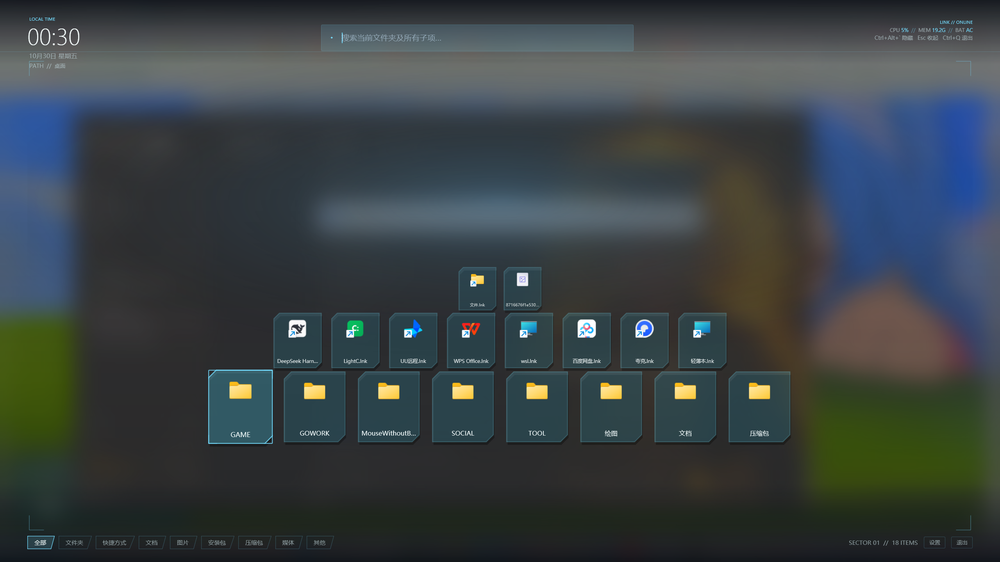

# LumenDeck（流光桌面 · 可运行原型）


单文件 Windows 桌面助手：Alt+` 唤起全屏伪 3D 浮层，浏览、筛选并打开桌面项目。视觉参考 SAO Utils 的 HUD 语言。




## 已完成（M0 + M1）

- .NET Framework 4.8.1 + WPF，系统自带 csc 编译，单 exe（约 42KB），无第三方 DLL、无安装器
- 单实例、托盘常驻、全局热键 Alt+`（注册结果写日志）
- 全屏浮层：Windows 11 系统背景（DWM Acrylic，实时模糊桌面），不截屏、不使用 WPF 分层透明窗口，保留硬件合成；Win10/异常时可以用 --snapshot 回到“快照+盒式模糊”
- 桌面扫描：8 类分组、系统图标（SHGetFileInfo）、名称排序
- 2.5D 场景：按行渐远、鼠标视差、入场动画、悬停/选中光晕；背景只保留柔光，不绘制透视网格线
- SAO HUD 皮肤：青色描边、切角卡片、四角括号、灭点准星、斜切分类按钮、顶/底 HUD 条
- 顶栏读数：CPU / 内存 / 电池，每 2 秒刷新
- 启动：先由深色遮罩平滑淡出到实时亚克力模糊，HUD 组件依次淡入；卡片按行列错峰上浮（图标本身不渐变），结束后镜头向前推进（上移 + 放大 4%）；搜索刷新时大卡片从下方滑入
- 交互：单击即发射——图标放大移动到屏幕中心，HUD 和其他卡片依次淡出，然后打开；文件夹单击直接进入；鼠标侧键后退/前进（历史）；Alt+←/→、Backspace、Alt+↑ 导航；Esc 返回/关闭；托盘/右下角/`Ctrl+Q` 退出
- --selftest：17 项纯逻辑自检（分类/布局/搜索/设置/热键解析）

> 当前最新：dist\LumenDeck-v21.zip（v20 全部功能 + 游戏加加/GameViewer 注入冲突自动兼容：启动检测自动切软件渲染、唤起前复检、崩溃自动接管重启，设置新增「渲染兼容」；图标缓存封顶 256 个，重搜索内存增长从 30MB+ 降到 ~1MB）。解压即用。

## 仓库与发布

源码可以直接提交到 Git；`bin/`、`dist/`、日志已在 `.gitignore` 中排除，编译产物作为 GitHub Release 附件单独上传。

```powershell
cd LumenDeck
git init
git add .
git commit -m "LumenDeck v8"
git remote add origin https://github.com/<you>/<repo>.git
git branch -M main
git push -u origin main
```

## 实时模糊参考

实现借鉴了 WPF UI 的 WindowBackdrop（DwmSetWindowAttribute + DWMSBT_TRANSIENTWINDOW + 扩展边框 + 透明 CompositionTarget）：

- WPF UI WindowBackdrop：https://github.com/lepoco/wpfui/blob/main/src/Wpf.Ui/Controls/Window/WindowBackdrop.cs
- AcrylicBackgroundLib（旧式 SetWindowCompositionAttribute + AllowsTransparency，会退化软件渲染）：https://github.com/achampagne1/AcrylicBackgroundLib
- DWMBlurGlass（系统级 DWM 模糊，思路参考）：https://github.com/Maplespe/DWMBlurGlass
- ModernWPF 对 WPF 背景材质限制的审计：https://github.com/kinnara/modernwpf/blob/23555a6c00623b2f80e67f20d7f1df49a1d28ad8/docs/window-backdrop-wpf-source-audit.md

界面交互参考：Desktop-Claw、LuckyIsland、Unbound Launcher。

## 构建

    powershell -ExecutionPolicy Bypass -File .\build.ps1

产物 bin\LumenDeck.exe（当前已验证成品在 dist\LumenDeck.exe）。

若 bin 下的 exe 正被运行占用，可换名构建：\n    .\build.ps1 -Name LumenDeck2

## 运行

- 设置：面板右下角“设置”打开完整设置（快捷键、实时模糊开关、遮罩浓度、动画时长、减少动画、开机自启）
- 退出：面板右下角“退出”、`Ctrl+Q`，或托盘图标右键“退出”（Win11 新图标默认可能收在 `^` 里）
- 双击 bin\LumenDeck.exe：托盘常驻，Alt+` 显示/隐藏
- 改键：托盘右键 →“设置快捷键…”；启动时若原热键被占用，会先尝试 Ctrl+Alt+`，仍失败会自动弹出设置窗；改完立即生效并写入 settings.json
- 打开文件夹：在浮层里点击文件夹或按 Enter 直接进入；左上 PATH // … 显示当前位置
- 返回上一级：点左上“↑ 上一级”、Backspace 或 Alt+↑；Esc 在子文件夹里先返回上一级，再按关闭
- 搜索：输入即递归搜索当前文件夹的所有子项（上限 8000 项，跳过隐藏/系统项与 node_modules/.git/AppData）；结果按需加载系统图标，以大卡片（5×4）从下方滑入，最多显示 20 项
- 全局类型筛选：点击底部“图片/文档/媒体…”会在桌面、文档、下载、图片、音乐、视频范围内递归检索该类型（最多 8000 项），结果同样以大卡片展示；Esc 先清筛选，再退回上级
- 旧版用 Alt+Space 的托盘进程请先右键退出；已有 settings.json 会自动迁移为 Alt+`
- --settings：启动后直接打开快捷键设置窗
- --safe：软件渲染，绕开游戏加加/GameViewer 的 D3D 覆盖层注入（画面会慢一些）。启动时会自动检测游戏加加并自动启用，通常无需手动加；--hardware 可强制硬件渲染
- --demo：启动后直接显示浮层，8 秒后退出（截图/演示用）
- --selftest：运行自检并写 bin\selftest.log
- --quit：通知已有实例退出（正常桌面环境）

## 崩溃排查

如果崩溃提示或事件查看器里出现 **GPP64.dll / GamePPSdk / GameViewer**（0xc0000005）：
这是“游戏加加 / GameViewer”注入游戏内覆盖层导致的，不是快捷键的问题。

新版已内置三道防线：①启动时检测到游戏加加自动切软件渲染（托盘有提示）；②游戏加加后启动时，按快捷键会先自动以 --safe 重启再显示；③运行中若仍被注入崩溃，会自动以 --safe 重启（一分钟最多一次）。设置 →“渲染兼容”可改为强制硬件/强制软件；检测进程名单可在 settings.json 的 GameppProcesses 里扩展。

仍崩溃时按顺序试：

1. 退出 GameViewer（托盘右键退出），或关闭它的“游戏内覆盖”，再把 LumenDeck.exe 加入排除
2. 任务管理器 → 详细信息，结束所有残留的 LumenDeck.exe，再启动
3. 必须保留 GameViewer 时，用 `LumenDeck.exe --safe` 启动（软件渲染，绕开 D3D 覆盖钩子）

## 已知限制（当前阶段）

- AI 对话、应用/文件搜索、桌面整理尚未接入（M2/M3/M4）
- 在 DSH 沙箱内运行时 AppData 不可写，日志回退到 bin\logs；正常双击运行写 %APPDATA%\LumenDeck
- 沙箱会隔离命名对象与键盘注入，自动化测试无法模拟全局热键；手动按 Alt+` 正常
- 4K/低端 GPU 尚未做降级策略；减少动态效果未接入

## 下一步

1. M2 搜索与启动：开始菜单/Get-StartApps 应用索引、桌面+文档+下载文件索引、统一排序、动作目录（锁屏/截图/设置页）
2. M3 AI：DeepSeek/OpenAI 兼容流式对话，右侧面板，白名单工具 + 二次确认，Key DPAPI 加密
3. M4 整理：桌面分类归档、预览、执行、撤销、冲突处理
4. M5 打磨：设置页、自启、多屏/DPI、减少动效、zip 交付
